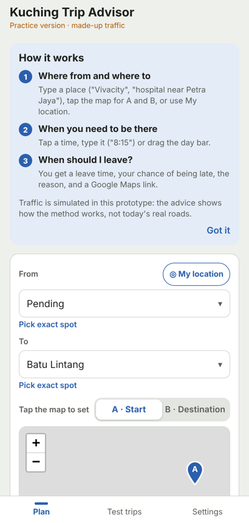
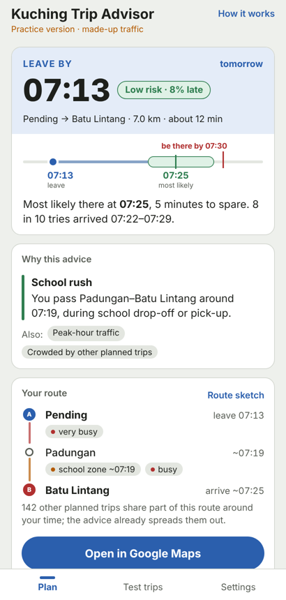

# Kuching Trip Advisor

**Hackerdorm × BuilderX Dormathon 2026 · Track 1: Predictive Model**

> *"Does your model help someone make a better decision, and can you prove it?"*

Every morning, people in Kuching guess when to leave. Kuching Trip Advisor turns that guess into a prediction: **leave at this minute, take this road, and here is your honest chance of being late, with the reason.** It plans each trip with everyone else's trips in mind, so it doesn't send the whole city down the same "fastest" road.

**Try it:** https://harrison-fx.github.io/navi-charter/ (works on a phone or laptop; no install, no account)
Backup link: https://raw.githack.com/harrison-Fx/navi-charter/main/docs/index.html

<p>

&nbsp;&nbsp;

</p>

> **Honesty note:** the traffic model is **simulated** from road types, time of day, school hours and assumed volumes. For trips leaving within the next couple of hours, the app also reads **live traffic speeds (TomTom)** and adjusts. The method is tested in simulation; real-world accuracy needs a pilot and real traffic counts (see [Limitations](#limitations)).

---

## 1. The problem

| What happens in Kuching | Why today's apps don't fix it |
|---|---|
| **School rush:** 38 schools with fixed drop-off and pick-up windows | Navigation apps react to traffic that already exists; they don't tell you *when to leave* |
| **Inflow\*:** Samarahan, Siburan, Matang, Samariang and Sejingkat drivers funnel through a few entry roads | |
| **Closures:** one closure dropped on-time trips from 91% to 62% in our simulation | |
| **The herd\*:** everyone gets the same shortcut, so it jams | Each app user is routed alone, ignoring everyone else |

\* *Inflow: people driving into Kuching from towns around it. The herd: many drivers sent the same "fastest" way at once.*

**Who it's for:** delivery fleets (they pay for late drops, fuel and driver time) and office commuters (the reach).

## 2. What we built

| Part | What it is | Where |
|---|---|---|
| **Web app** (main demo) | Plan a trip, get a leave-by time, chance of being late, reason, route and a Google Maps link | [`mobile/`](mobile/) (built site in [`docs/`](docs/)) |
| **Prediction model** | Traffic simulation and evaluation for a 400-van fleet over 60 school days | [`kuching_advisor.py`](kuching_advisor.py) |
| **Results** | Numbers, charts, robustness tests | [`outputs/`](outputs/) |
| **Android app** | Same app, built with Expo (React Native); offline | [`mobile/`](mobile/) |
| **Pitch** | Demo script, Q&A sheet, numbers | [`PITCH_PACK.md`](PITCH_PACK.md) |

**App features**
- **Easy places:** type a name with context (`hospital near Petra Jaya`, `7-Eleven near Saradise`, `office, Jalan Stutong`), tap a street map for A and B and drag the pins, or use your location.
- **Easy time:** tap a common time, type it (`8:15`, `815`, `8.15pm`) or drag a day bar that shows busy periods.
- **The answer:** leave-by time with countdown, risk level (Low / Medium / High), a timeline to your deadline, minutes to spare, the main reason, and each stretch of road flagged (school zone, very busy, lots of traffic from Samarahan, reported jam).
- **Act on it:** open Google Maps (we plan, Maps drives), reminder, share as message.
- **Live traffic (TomTom):** for trips leaving within about 2 hours today, current speeds on each road along the route adjust the prediction; slow roads are flagged "live: 14 km/h now (normally 42)". Further ahead (e.g. tomorrow) it uses the model only, because live traffic can't see the future. Switch in Settings, with a "Test live traffic" button.
- **Road reports:** mark a road closed or jammed and the advice routes around it.
- **Themes:** Light, Dark, Navy, Midnight. No account needed; settings stay on the device.

## 3. How the prediction works

1. **City graph:** OpenStreetMap roads of Greater Kuching, 38 schools, 5 entry roads from surrounding towns.
2. **Congestion:** the BPR\* volume-delay formula, minute by minute, with morning inflow and evening outflow tides.
3. **Uncertainty:** each departure time is tried hundreds of times with random traffic (Monte Carlo\*), giving a **chance of being late** and an **arrival range**, not a single guess.
4. **Herd-aware\*:** each trip is planned against the trips already planned, spreading people across roads.
5. **Sensible routes:** it only sends you a different way if you can leave at least 3 minutes later or be clearly safer; otherwise it keeps the usual road.
6. **Live check (trips leaving soon):** for trips leaving within about 2 hours today, the app reads TomTom's current speed on each road of the candidate routes and slows those roads by how much slower than normal they are now. The adjustment is full for the next 20 minutes and fades out by about 2.5 hours, because live traffic can't see further ahead.

\* *BPR: the standard traffic-engineering formula; travel time climbs steeply as a road fills. Monte Carlo: re-running a trip many times with random traffic. Herd-aware: planning each trip around everyone else's.*

Not machine learning, on purpose: Kuching has no years of trip data to learn from. The model is transparent, and real traffic counts can calibrate it directly.

## 4. Can we prove it? (simulated results)

400 delivery vans, school-day mornings, 60 days × 3 random seeds, compared with two baselines: **fixed routes** (same road every day) and a **typical app** (everyone takes the app's fastest road). The "real" traffic is generated separately from, and noisier than, what the model sees.

| School-day morning | Fixed routes | Typical app | **Our advisor** |
|---|---|---|---|
| On time, normal day | 88.1% | 91.1% | **91.2%** |
| On time, road closed | 54.1% | 62.1% | **63.8–65.0%** |
| Fuel + driver cost, normal (RM/day) | 2,642 | 2,591 | **2,579** |
| Fuel + driver cost, road closed (RM/day) | 5,123 | 3,136 | **3,080** |

- **RM 2,043 saved** on a closure morning versus fixed routes, for a 400-van fleet.
- **Late warnings:** 80% of late trips are flagged in advance and 72% of flags are right on a normal day; 94% / 91% on closure days. Brier score 0.03 (0 = perfect).
- **Honest chances:** the [calibration chart](media/calibration.png) shows the predicted chance of being late against what actually happened. Our estimates lean cautious (they over-warn rather than under-warn).
- **Robust to bad data:** with noisier traffic or a poorer live reading, the advisor still beats the typical app on closure days at every level tested (+0.6 to +1.9 points). Warning accuracy depends most on the live reading.
- **Timing matters most:** leaving at 07:30 instead of 07:00 lifted on-time from 91% to 96%. That is why the app leads with *when to leave*.

Full output: [`outputs/v7/`](outputs/v7/) (numbers above), [`outputs/v9/`](outputs/v9/) (rerun, calibration, noise test). Regenerate the table with `python pitch_numbers.py approx outputs/v7`.

## 5. Try it yourself (about 3 minutes)

Open https://harrison-fx.github.io/navi-charter/ (or the backup link above).

1. **A normal school morning.** From `Pending`, To `Batu Lintang`, tap **07:30**, choose **Tomorrow** and **School day**, then **When should I leave?**
   *Expect:* leave about 07:13, Low risk, and "School rush" as the reason, with the school zone flagged on Padungan–Batu Lintang.
2. **Type with context.** In To, type `hospital near Petra Jaya`. Suggestions are ranked by distance from Petra Jaya.
3. **Something goes wrong.** Open **Road reports**, pick `Padungan–Pending`, tap **Closed / accident**, then ask again. The route avoids that road, the leave time moves earlier (about 07:04) and "Road closure" becomes the reason.
4. **Coming from outside Kuching.** From `Samarahan` to `City Centre`, arrive **08:00**. The reason becomes "Traffic from outside Kuching" and the busy stretches say "lots from Samarahan".
5. **Use the map.** Tap the map to set A, then B, and drag a pin. Online, the pin is named after the street.
6. **Live traffic:** in **Settings → Traffic**, tap **Test live traffic** (it shows the current speed near the city centre). Then plan a trip for **Today** arriving 30–90 minutes from now: the result says "Live traffic checked at …" and flags any road that is slow right now.
7. **Settings:** switch themes; "Demo" makes *My location* pretend you're in a chosen area (handy indoors).

## 6. Run it locally

| To | Do |
|---|---|
| Open the web app offline | Windows: double-click `mobile/START-WEB-DEMO.bat`, or open `mobile/web-demo/index.html` in a browser (the street map needs internet; everything else works) |
| Rebuild the web app | `cd mobile && npm install && npm run web-demo` (Node 20+) |
| Run the model | `pip install -r requirements.txt` then `python kuching_advisor.py` (approximate map, a few minutes) |
| Run it on the real road map | Windows: double-click `RUN-REAL-MAP.bat` (downloads OpenStreetMap once; 30–90 minutes) |
| Robustness tests | `python kuching_advisor.py --noise-scan`, `--wave-scan`, `--fake-scan`, `--priority-scan` |
| Android app | `mobile/OPEN-LAUNCHER.bat` (Expo Go) or `mobile/BUILD-APK.bat`; see [`mobile/README.md`](mobile/README.md) |

## 7. Limitations

We'd rather say these first:
- **Traffic is simulated** beyond the next couple of hours. Volumes are assumptions until JKR or council traffic counts are available; real-world accuracy is not yet measured. Live speeds are sampled at one point per road on our simplified map.
- **Main results use an approximate 16-area map.** The real-road run is scripted (`RUN-REAL-MAP.bat`) but not yet in the table.
- **School hours are not confirmed** for every school; the app says so.
- **Landmark positions in place search are approximate** (about ±1 km); pins can be dragged.
- **Live traffic only covers the next couple of hours** and is sampled at one point per road; it uses TomTom's free tier (about 2,500 requests a day).
- **Not covered yet:** weather and events (road reports and live speeds are the stand-in).

## 8. What's next

1. **One-week pilot:** one fleet and 20 commuters; the app's built-in test log times every real trip against its prediction.
2. **Real data:** council and JKR traffic counts and historical speed patterns (so predictions for tomorrow use real data too), confirmed school sessions.
3. **Shared road reports and a small server** so planned trips spread across all users, not just one phone.

## Repository map

```
README.md            this report
PITCH_PACK.md        rubric map, demo script, Q&A, numbers
TECHNICAL.md         model options, outputs, design decisions (detailed)
BLUEPRINT.md         design document;  JOURNAL.md  build log
kuching_advisor.py   prediction model and evaluation
pitch_numbers.py     prints the results table from a results file
RUN-REAL-MAP.bat     real-road-map runs (Windows)
outputs/             results, charts, robustness tests
mobile/              the app (Expo / React Native, web + Android)
  web-demo/          built web app (open index.html)
docs/                the same build, served by GitHub Pages
data/                schools list and map cache
media/               screenshots for this page
poc/, prototype/, archive/   earlier versions
```

**Team:** [Team name · members · contact]
